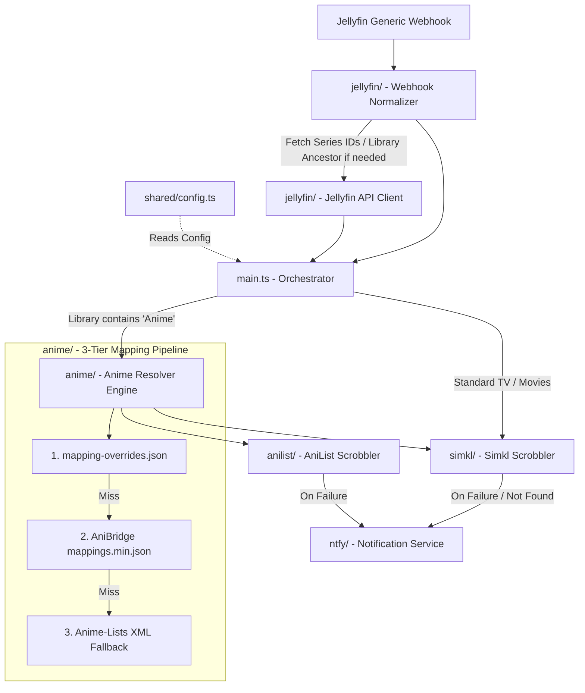

# jellyfin-tracker-sync

A lightweight, high-performance media sync webhook server built in TypeScript with Bun. It listens directly to Jellyfin playback webhook events, automatically routes between Anime (using AniBridge cross-referencing to AniList with TVDB fallback) and standard TV Shows/Movies (using TVDB, TMDB, and IMDb IDs), and synchronizes watch history to your Simkl and AniList accounts.

It supports multi-user setups, sends failure notifications to a `ntfy` server, and is designed with a clean, decoupled service architecture.

---

## 🏛️ Architecture & Core Components



- **[index.ts](./index.ts)**: The HTTP entry point using `Bun.serve`. Initializes the anime mapping indices in the background and dispatches `/webhook` requests asynchronously to prevent Jellyfin timeouts.
- **[main.ts](./main.ts)**: The system orchestrator. Handles user credential verification, inspects library names, directs anime vs non-anime routing, coordinates watch history logging to Simkl and AniList, and intercepts failures to send push notifications.
- **[anime/](./anime)**: The anime cross-referencing and mapping engine:
  - **Overrides** (`mapping-overrides.json`): User-configured overrides managed via the Web UI (`/overrides`) or JSON, evaluated with top priority.
  - **AniBridge** (`mappings.min.json`): Fast, indexed mappings translating TVDB/TMDB seasons into AniList entries with support for continuous seasons, specials, multi-part ratios, and movies.
  - **Anime-Lists** (`anime-list-full.xml`): Community XML fallback for unplaced titles.
- **[jellyfin/](./jellyfin)**: Webhook normalizer and lightweight Jellyfin API client with in-memory caching to resolve series IDs and parent collection/library names if missing from the webhook payload.
- **[simkl/](./simkl)**: Simkl API scrobbler. Syncs completed watch events (>= 80% progress or marked played) with native AniList entries (with TVDB fallback) for anime, or TVDB/TMDB/IMDb IDs for non-anime media.
- **[anilist/](./anilist)**: AniList GraphQL scrobbler. Updates watch progress and list completion status on AniList with anti-regression protection, rate-limit backoff, and debouncing.
- **[ntfy/](./ntfy)**: Generates and posts failure notifications to `ntfy` server topics.
- **[shared/](./shared)**: Exposes typed configurations loaded dynamically from `config.toml` at startup.

---

## ✨ Features

- **Direct Jellyfin Webhook Ingestion**: Listens directly to Jellyfin's Generic Webhook destination.
- **Dual Pipeline (Anime & Non-Anime)**: Automatically identifies Anime libraries (libraries containing `"Anime"` case-insensitively, e.g. `"Anime"`, `"Anime Movies"`) and routes them through the anime mapping engine (AniList primary with TVDB fallback), while routing standard TV Shows and Movies directly via TVDB, TMDB, and IMDb IDs.
- **AniBridge Cross-Referencing**: Translates continuous TVDB season numberings into distinct AniList media entries and 1..N episode numbers automatically.
- **Custom Overrides & Web UI**: Manage manual overrides at `http://localhost:3000/overrides` or directly in `mapping-overrides.json`.
- **Automated Background Refresh**: Periodically checks and hot-swaps expired mapping caches in the background every 24 hours without server restarts, and supports manual on-demand reloads via `POST /mappings/refresh`.
- **Strict Episode & Movie Scrobbling**: Only scrobbles media once playback finishes (reaching $\ge 80\%$ or marked played).
- **Multi-User Friendly**: Supports multi-user households by mapping different Jellyfin usernames directly to their respective Simkl tokens.
- **Failure Alerts via ntfy**: Sends clickable link alerts to your configured `ntfy` topic if a regular episode is missing or unmapped in Simkl.

---

## 🛠️ Prerequisites

- **[Jellyfin](https://jellyfin.org/) 10.9.X+** with **Webhook plugin** (Generic destination configured to POST to `http://<bridge-host>:3000/webhook`)
- **[Simkl](https://simkl.com/) account**
  - **Client ID**: Register an application in the [Simkl Developer Console](https://api.simkl.org/api-reference/introduction).
  - **User Access Tokens**: Each user mapped in the application requires a Simkl Bearer Token.
- **[ntfy](https://ntfy.sh/) server** _(optional, skipped if omitted from config)_
- **[Bun Runtime](https://bun.sh/) 1.X** installed locally.

---

## 🚀 Getting Started

### 1. Installation

If you use [mise](https://mise.jdx.dev/) (recommended):

```bash
mise trust
mise install
```

Otherwise, install with Bun:

```bash
bun install
```

### 2. Configuration & Simkl App Setup

1. **Create Simkl Developer App**:
   - Go to [simkl.com/settings/developer/new/](https://simkl.com/settings/developer/new/)
   - Set **Redirect URL** to: `http://<your-server-ip-or-host>:3000/auth/callback` (or `http://localhost:3000/auth/callback` for local testing).
   - Copy your generated **Client ID** and **Client Secret**.

2. **Configure `config.toml`**:
   Create a `config.toml` in the root of the project (or copy from `config.example.toml`):

```toml
[jellyfin]
url = "http://YOUR_JELLYFIN_SERVER:8096"
token = "YOUR_JELLYFIN_API_KEY"

[simkl]
app_name = "jellyfin-tracker-sync"
client_id = "YOUR_SIMKL_CLIENT_ID"
client_secret = "YOUR_SIMKL_CLIENT_SECRET"
# Optional explicit callback override (defaults to http://<host>:3000/auth/callback)
# redirect_uri = "http://YOUR_SERVER_IP:3000/auth/callback"

[simkl.users]
# Tokens can be automatically populated via the Web Dashboard at http://localhost:3000/

[anilist]
# Optional AniList setup: Register at https://anilist.co/settings/developer
client_id = "YOUR_ANILIST_CLIENT_ID"
client_secret = "YOUR_ANILIST_CLIENT_SECRET"
# redirect_uri = "http://YOUR_SERVER_IP:3000/auth/anilist/callback"

[anilist.users]
# Tokens can be automatically populated via the Web Dashboard at http://localhost:3000/

[ntfy]
url = "https://ntfy.sh"
token = "YOUR_NTFY_AUTH_TOKEN"
topic = "YOUR_NTFY_TOPIC"
```

### 3. User Authentication Dashboard & Auto-Refresh

Open your browser to **`http://<your-server-ip>:3000/`** (or `/auth`):

- **Auto-Populated User List**: Automatically queries Jellyfin for your existing users.
- **One-Click OAuth**: Select a user from the dropdown and link with **Simkl** and/or **AniList**.
- **Automated Storage**: After authorizing, callbacks securely exchange authorization codes and save access tokens directly into `config.toml` and runtime memory.
- **Automatic Background Token Refresh**: Simkl access tokens are refreshed automatically in the background every 24 hours. AniList 1-year tokens are validated live on the dashboard with expiration tracking.
- **Health Checks & Manual Controls**: Displays live token validity and expiration countdowns for each user, with on-demand **↻ Refresh** and **Re-authorize** buttons. Legacy string tokens (`username = "token"`) remain fully supported.

### 4. Mapping Overrides (Optional)

You can manage overrides using the built-in Web Editor at **`http://<your-server-ip>:3000/overrides`**, or directly edit `mapping-overrides.json` in the root or configuration directory:

```json
{
  "70861": {
    "title": "Love Hina",
    "seasons": {
      "1": {
        "episodes": {
          "25": {
            "name": "Final Special",
            "anilistId": null
          },
          "26": {
            "name": "Christmas Special",
            "anilistId": 444,
            "anilistEpisode": 1
          }
        }
      }
    }
  }
}
```

### 5. Running Locally

Start development server with live reload:

```bash
bun run dev
```

Or run in production mode:

```bash
bun start
```

---

## 🧪 Testing, Linting & Formatting

```bash
# Run unit tests
bun run test

# Lint code
bun run lint

# Format code
bun run format
```

---

## 🐳 Docker Setup

Build and run with Docker:

```bash
docker build -t jellyfin-tracker-sync .

docker run -d \
  --name jellyfin-tracker-sync \
  -p 3000:3000 \
  -v /path/to/config-dir:/config \
  jellyfin-tracker-sync
```

---

## 📄 License

Distributed under the MIT License. See [LICENSE](./LICENSE) for more information.
